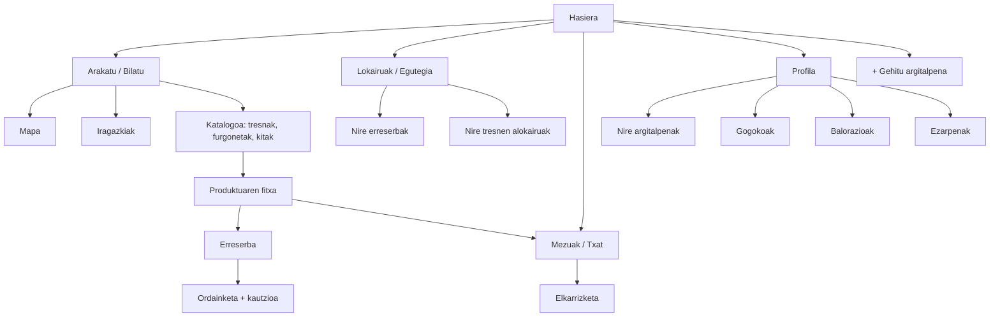

# TrukeGarai

Auzokideen artean tresnak eta furgonetak alokatu, utzi edo trukatzeko aplikazioa. Etxeko gauzei errendimendua atera eta tokiko ekonomia zirkularra bultzatzeko sortua!

---

## Aurkibidea

1. [Sarrera](#1-sarrera)
2. [Merkatuaren azterketa (benchmarking)](#2-merkatuaren-azterketa-benchmarking)
3. [Erabiltzailearen profila](#3-erabiltzailearen-profila)
4. [Nabigazio mapa](#4-nabigazio-mapa)
5. [Krokisa edo bozetoa (mobile eta desktop)](#5-krokisa-edo-bozetoa-mobile-eta-desktop)
6. [Estilo gida](#6-estilo-gida)
7. [Prototipoa](#7-prototipoa)
8. [Edukien lizentzia](#8-edukien-lizentzia)
9. [Erabilgarritasunaren azterketa](#9-erabilgarritasunaren-azterketa)
10. [Bibliografia](#10-bibliografia)

---

## 1. Sarrera

TrukeGarai gure inguruko jendearekin tresnak partekatzeko plataforma bat da. Zerk bereizten gaitu? **Katalogo berean aurkituko dituzu bai behar dituzun tresnak, bai horiek etxera eramateko ibilgailuak**.

**Bi aldeei laguntzen diegu:**
* **Erabiltzaileei:** Gauzak erosi edo etxean lekua hartzen ikusi ordez, unean uneko tresnak edo furgonetak merkeago lortzeko.
* **Jabeei:** Garajean hautsa hartzen ari diren tresnei modu seguruan diru pixka bat ateratzeko.

Aplikazioak katalogoa, argitalpen azkarrak egiteko aukera, txata eta profila ditu. Mapari eta iragazkiei esker, gertu dituzun gauzak ikusi, fitxa aztertu eta zuzenean erreserbatzen dituzu auzokideekin.

---

## 2. Merkatuaren azterketa (benchmarking)

Inguruan dauden beste aukeren onena hartu dugu eta dituzten hutsuneak konpondu ditugu:

| Plataforma | Zertan zentratzen da | Hutsunea | TrukeGarai-ren erantzuna |
|---|---|---|---|
| [Peerby](https://www.peerby.com/en-us) | Edozein objektu partekatzea (orokorra) | Gauza gehiegi nahasita | Brikolajean eta etxeko lanetan espezializatuta |
| [Bueydu](https://bueydu.com/) | Makineria astuna | Etxeko erabiltzailearentzat handiegia | Etxeko tresnak eta furgonetak katalogo berean |
| [ShareTools](https://sharetools.es/agregar-herramienta) | Tresnak alokatzea | Txatetik edo deituz adostu behar da beti | Erreserba eta ordainketa % 100 automatikoak |

**Gure abantailak:**
* **Espezializazioa:** Brikolajea eta etxeko lanak.
* **Erreserba azkarra eta automatikoa:** Webgunean bertan, txatean denbora galdu gabe.
* **Segurtasun osoa:** Estaldura-asegurua eta kautzioen atxikipen automatizatua, kalteen beldurra kentzeko.
* **Proiektuko kitak:** Proiektu zehatzetarako prestatutako tresna-kitak (adibidez: "zorua jartzeko kita").
* **Interfaze modernoa** eta erabiltzeko erraza.

---

## 3. Erabiltzailearen profila

Gure erabiltzaile nagusia **brikolaje-zale eraginkorra** da:
* 28 eta 55 urte bitarteko pertsonak.
* Etxean edo lorategian noizean behin proiekturen bat egiten dutenak.
* Behin bakarrik erabiliko duten zerbaitetan dirua gastatu nahi ez dutenak.

### Zein arazo konpontzen dizkiogu?
* **Beste web batzuetako arazoak:** Gauza gehiegi nahasita, orri konplexuak, txatetan denbora galtzea edo tresnak hondatzeko beldurra.
* **Gure soluzioa:** Proiektukako kitak, erreserba eta ordainketa azkarrak, babes-asegurua eta plataforma oso erraz eta intuitiboa.

---

## 4. Nabigazio mapa

Aplikazioaren egitura beheko menuko bost ataletan oinarritzen da:

---

## 5. Krokisa edo bozetoa (mobile eta desktop)

### Mugikorra

### Ordenagailua

---

## 6. Estilo gida

### 6.1. Koloreak
- **Berde nagusia:** Botoi nagusiak, akzioak, ikono aktiboak eta aukeratutako elementuak.
- **Gris argia:** Atzeko planoak, bilaketa-barrak, txartelen atzeko planoa eta banatzaileak.
- **Beltza / Gris iluna:** Tituluak eta testu nagusiak.
- **Zuria:** Txartelen barrualdea eta botoi batzuen atzeko planoa.

### 6.2. Tipografia
- **Mota:** Modernoa, Sans-Serif.
- **Pisua (weights):**
  - **Lodia:** Titulu, prezio eta elementu garrantzitsuetarako.
  - **Normala:** Deskribapen eta testu txikietarako.

### 6.3. Botoiak
- **Nagusia:** Berde atsegina, ertz biribilduak, testu zuriarekin.
- **Sekundarioa:** Zuria, ertz finarekin edo atzeko plano gris argiarekin.

### 6.4. Irudiak
- **Produktuak:** Txartel karratu edo laukizuzenak, izkina biribildu txikiekin.
- **Erabiltzaileak:** Profil irudi borobilak.

### 6.5. Ikonoak
- **Beheko menua:** Hasiera, Arakatu / Bilatu, Lokairuak / Egutegia, Mezuak / Txat, Profila.
- **Beste batzuk:** Lupa, Gehitu (+), Kokapena (pin), Bihotza (Gogokoak), Balorazio izarrak.

---

## 7. Prototipoa

🔗 [TrukeGarai prototipoa Figma-n](https://www.figma.com/make/1tzNiJBsYTJrPsHr0uF3Zx/Web-page-for-TrukeGarai?t=jpz4V6PQyxFIaq9H-1)

---

## 8. Edukien lizentzia

Proiektu honen edukiak (testuak, bozetoak eta diseinuak) [Creative Commons Aitortu-PartekatuBerdin 4.0 Nazioartekoa (CC BY-SA 4.0)](https://creativecommons.org/licenses/by-sa/4.0/deed.eu) lizentziapean daude.

Honek esan nahi du edukiak partekatu eta egokitu daitezkeela, betiere egilea aitortzen bada eta lan eratorriak lizentzia berarekin banatzen badira.

Prototipoan erabilitako irudi eta ikonoek beren jatorrizko lizentziak dituzte.

---

## 9. Erabilgarritasunaren azterketa

| # | Datuak | Informazioa |
|---|---|---|
| 1 | Sistemaren egoeraren ikusgarritasuna | Erreserba eta ordainketaren egoera "Lokairuak" atalean ikusten da; beheko menuan ikono aktiboa berdez nabarmentzen da. |
| 2 | Sistemaren eta mundu errealaren arteko lotura | Hizkuntza argia eta ikono ezagunak (lupa, bihotza, pin-a, izarrak). |
| 3 | Erabiltzailearen kontrola eta askatasuna | Erreserbak kudeatu edo ezeztatu daitezke egutegitik. |
| 4 | Koherentzia eta estandarrak | Kolore, botoi eta txartel estilo bera pantaila guztietan. |
| 5 | Akatsen prebentzioa | Erreserba automatikoak eta kautzioak gatazkak eta gaizki-ulertuak saihesten dituzte. |
| 6 | Gogoratu baino, ezagutu | Beheko menua beti ikusgai; kategoriak eta iragazkiak bistan. |
| 7 | Erabilera malgutasuna eta eraginkortasuna | Proiektuko kitek tresna bat baino gehiago ekintza bakarrean erreserbatzeko aukera ematen dute. |
| 8 | Diseinu estetiko eta minimalista | Kolore paleta mugatua, zuriune ugari eta informazio garrantzitsua soilik txarteletan. |
| 9 | Akatsak ezagutzen, diagnostikatzen eta konpontzen laguntzea | Mezu argiak eta txata jabearekin arazoak konpontzeko. |
| 10 | Laguntza eta dokumentazioa | Asegurua eta kautzioak nola funtzionatzen duten azaltzen da fitxan. |

### Hobetzeko aukerak
- Erabiltzaile errealekin probak egitea (5 pertsona inguru, profil nagusiarekin bat datozenak) eta zereginak neurtzea: tresna bat bilatu, erreserbatu eta ordaindu.
- Lehen aldiz sartzen direnentzat tutorial edo gida laburra gehitzea.
- Kontraste nahikoa egiaztatzea (WCAG 2.1 AA) berde nagusiaren eta testu zuriaren artean.

---

## 10. Bibliografia

- Peerby. (d.g.). *Peerby*. https://www.peerby.com/en-us
- Bueydu. (d.g.). *Bueydu*. https://bueydu.com/
- ShareTools. (d.g.). *ShareTools*. https://sharetools.es/agregar-herramienta
- Nielsen, J. (1994). *10 Usability Heuristics for User Interface Design*. Nielsen Norman Group. https://www.nngroup.com/articles/ten-usability-heuristics/
- W3C. (2018). *Web Content Accessibility Guidelines (WCAG) 2.1*. https://www.w3.org/TR/WCAG21/
- Creative Commons. (d.g.). *CC BY-SA 4.0*. https://creativecommons.org/licenses/by-sa/4.0/
- Figma. (d.g.). *Figma*. https://www.figma.com/
